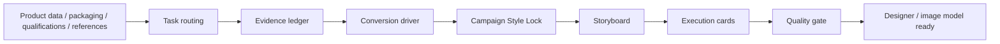

<div align="center">

# 🛒 E-commerce Visual Copywriting

### Main Images · PDP / Detail Page · Amazon Listing / A+ · On-image Copy · Image Prompts · Compliance Review

**Turn fragmented product inputs into an execution-ready e-commerce visual system for designers and AI image models.**

[](SKILL.md)
[](SKILL.md)
[](https://skills.sh/feichanggege/ecommerce-visual-copywriting-skill)
[](LICENSE)
[](https://github.com/feichanggege/ecommerce-visual-copywriting-skill/actions/workflows/verify.yml)

[中文](README.md) · **English**

[Quick Start](#-quick-start) · [Why It Exists](#-why-it-exists) · [Workflow](#-workflow) · [Platforms](#-platforms) · [Showcase](#-showcase) · [Safety](#-safety)

</div>

<p align="center">
  
</p>

The overview is a teaching reconstruction using existing durian artwork: request → evidence ledger → execution card → visual reference. Its origin/D197 claims still need source evidence; the artwork is not a new render of the revised card. [Read the traced example](examples/durian-worked-example.md).

The Skill adds purchase reasoning, an **Evidence Ledger**, **Style Lock**, execution cards, and production constraints. Image prompts reserve whitespace by default; designers/layout tools add the final text.

---

## ✨ Why It Exists

| Common failure | How this Skill handles it |
|---|---|
| Five images repeat the same selling point | Each image solves one purchase-decision question |
| Specifications are copied without meaning | `Feature → Advantage → Benefit → Evidence` |
| Reference images drift away from the real product | Reference Fidelity locks packaging, logo, structure, and specs |
| Aggressive copy creates unsupported claims | Evidence ledger before final claims |
| Existing pages get rebuilt from scratch | Audit/revision mode makes the minimum necessary changes |
| Cross-border pages are literal translations | Localizes reasoning, units, scenarios, and information density |
| Old platform knowledge is stated as current policy | Current rules are verified from official sources when needed |
| Copy is not usable by a designer | Each image includes scene, copy, rationale, prompt, negative prompt, and evidence notes |

---

## 🚀 Quick Start

```bash
npx skills add feichanggege/ecommerce-visual-copywriting-skill
```

Also see [manual installation, Claude Code marketplace, and Claude.ai ZIP upload](#installation-options).

Then ask:

```text
Here are the product materials, packaging images, and reference images.
For Amazon US, create 7 listing images plus an A+ visual plan in one pass.
For each image include the scene, English on-image copy, design rationale,
image-generation prompt, negative prompt, and evidence notes.
Do not invent missing facts; label assumptions explicitly.
```

Or simply:

```text
Turn this product into an execution-ready main-image and PDP plan for my designer.
```

---

## 🧭 Workflow



### Four execution modes

| Mode | Use when | Behavior |
|---|---|---|
| **Standard** | Critical evidence/direction missing, or user requests a checkpoint | Strategy/gaps → one combined checkpoint after Storyboard → execution |
| **One-shot** | Inputs are clear or user asks for full delivery | Completes the workflow without unnecessary pauses |
| **Audit / revision** | Existing images, copy, prompts, or PDP | Finds problems and applies minimum necessary changes |
| **Designer handoff** | Production needs a structured brief | Outputs consistent image/module execution cards |

Default priority: finished work to review → Audit; designer/operator-ready brief → Handoff; sufficient inputs/evidence for this scope → One-shot; critical gaps → Standard. Source product photos alone do not trigger Audit, and three selling points are not a quota. Every complete plan/strategy/storyboard and formal audit reads the shared output contracts.

### What v3 adds

- **Evidence Ledger** — classifies claims as Verified / Supported / Needs proof / Disallowed.
- **Reference Fidelity** — defines what must stay and what may change.
- **Negative Constraints** — blocks packaging drift, logo changes, wrong specs, text artifacts, anatomy errors, etc.
- **Dynamic image count** — five is a default, not a hard rule.
- **Multi-platform playbooks** — China e-commerce + Amazon / Shopify / TikTok Shop / Temu / Shopee / Lazada.
- **Copy limits and typography** — main image: one headline, up to two support lines and one number/evidence tag; PDP module: one headline and up to three points. Headlines: ≤12 Chinese characters/≤6 English words; main-image support: ≤18 characters/≤10 words; PDP points: ≤18 characters/≤12 words. These are defaults, not platform rules; cut or split rather than shrink type.
- **One text method per card** — Layout-reserved (default post-production typography) or Model-rendered (only explicitly requested short text), with a copy-spec self-check and character-by-character acceptance/fallback. Keep bottom disclaimers readable and material conditions beside claims.
- **Six conversion drivers** — visual, pain point, parameters, trust, emotion, and price/bundle/promotion with verified conditions.
- **Cross-border localization** — rewrites purchase reasoning instead of literal translation.
- **Hard blockers + Pass/Fail gates** — replaces arbitrary 80/100 scoring.

---

## 📦 Deliverables

The Skill can produce:

- Conversion driver + up to three supported purchase reasons
- Evidence ledger
- `Feature → Advantage → Benefit → Evidence`
- Campaign Style Lock
- Main-image / PDP / Listing / A+ storyboard
- Scene and composition descriptions
- On-image copy
- Design rationale
- Image-generation prompts
- Negative prompts / forbidden changes
- Evidence and compliance notes
- Audit/revision reports
- Cross-border localization

A typical image set may use roles such as:

```text
Hero      → identify the product + one primary reason to click
Benefit   → translate a feature into customer value
Proof     → build trust with real evidence
Scene     → create usage relevance
Spec/CTA  → reduce selection friction
```

The actual count depends on the platform and product.

---

## 🌍 Platforms

| China | Cross-border / DTC |
|---|---|
| Taobao / Tmall | Amazon Listing / A+ / Brand Story |
| JD | Shopify / DTC PDP |
| Pinduoduo | TikTok Shop |
| Douyin Shop | Temu |
| Xiaohongshu product images / note covers | Shopee / Lazada |
| WeChat Channels covers / WeChat Shop | Other PDP scenarios |

Stable visual strategy lives in `references/platform-playbooks.md`. Time-sensitive requirements such as image restrictions, dimensions, category qualifications, or claim policies should be verified against current official platform documentation when needed.

Douyin Shop and TikTok Shop have separate playbooks. [Official source notes](references/source-notes.md) distinguish reviewed texts, navigation entry points, markets, and access limits.

---

## 🧪 Example Requests

```text
Give me the strategy and storyboard first. Wait before final execution.
```

```text
The inputs are complete. Deliver the full set in one pass without checkpoints.
```

```text
Do not rebuild this PDP. Audit conversion, visual hierarchy, and compliance risks,
then give me the minimum-change revision.
```

```text
Use this packaging image as the source of truth. Logo, color, size, and container shape must not change.
```

```text
Localize this Chinese PDP for Shopify US. Do not translate literally.
```

More examples: [examples/README.md](examples/README.md).

---

## 🖼 Showcase

<div align="center">
  <table>
    <tr>
      <td align="center" width="50%">
        <a href="assets/showcase/musang-king-durian-main.jpg"></a><br>
        <strong>Premium Food Hero</strong>
      </td>
      <td align="center" width="50%">
        <a href="assets/showcase/figure-multi-angle.jpg"></a><br>
        <strong>Multi-angle Product View</strong>
      </td>
    </tr>
    <tr>
      <td align="center" width="50%">
        <a href="assets/showcase/figure-desktop-scene.jpg"></a><br>
        <strong>Lifestyle Detail Module</strong>
      </td>
      <td align="center" width="50%">
        <a href="assets/showcase/lumina-pendant-lamp.jpg"></a><br>
        <strong>Material & Lighting</strong>
      </td>
    </tr>
  </table>
</div>

> Showcase images demonstrate output formats only. They are not legal opinions, platform approval guarantees, or proof of commercial claims.

Each asset is at most 500KB; the durian thumbnail preserves the complete portrait. Historical Git blobs remain in history. Use a shallow clone or current-source archive for a smaller download.

---

## 🛡 Safety

This Skill does not:

- Fabricate tests, certificates, patents, approvals, sales, reviews, rankings, or testimonials.
- Present “Needs proof” claims as facts.
- Preserve unsupported medical/health claims by hiding behind a disclaimer.
- Treat historical platform knowledge as guaranteed current policy.
- Change product packaging, logo, specifications, or structure for visual convenience.

See [references/compliance-rules.md](references/compliance-rules.md).

---

## 🗂 Repository Structure

```text
SKILL.md                          # Canonical runtime entrypoint
SKILL.en.md                       # Full English companion with section-alignment checks
agents/openai.yaml                # ChatGPT UI metadata
references/compliance-rules.md    # Evidence & compliance framework
references/platform-playbooks.md  # Multi-platform visual strategy
references/output-contracts.md    # Handoff / audit / localization templates
references/source-notes.md        # Official sources, scope and access limits
examples/README.md                # Example requests and expected behavior
examples/durian-worked-example.md # Traced teaching example
scripts/count-copy.py             # Count final copy strings
assets/showcase/                  # Showcase assets
assets/showcase-output.svg        # Structured-output overview
tools/verify-skill.py             # Pre-release checks
tools/evaluate-prompts.py         # Evaluate saved agent responses
tools/package-skill.py            # Minimal upload ZIP
test-prompts.json                 # 14 scenarios with lexical expectations
.github/workflows/verify.yml      # GitHub Actions
CHANGELOG.md                      # Released / unreleased changes
```

## ✅ Verification

```bash
python tools/verify-skill.py
python -m unittest discover -s tests -v
```

Actions runs offline verification, regression tests and minimal packaging. The badge reports the actual workflow state after it is pushed; local success is separate from remote CI.

Evaluate saved real outputs with `python tools/evaluate-prompts.py --responses responses.json`. `must_include` applies to the full response; `must_not_include` applies only to a separate publishable `final_copy` excerpt, so risk analysis may quote forbidden phrases. [Format and limits](examples/README.md#自动检查实际输出). Lexical checks do not establish semantic/legal correctness or visual acceptance.

The repository already has a [v3.0.0 Release](https://github.com/feichanggege/ecommerce-visual-copywriting-skill/releases/tag/v3.0.0). This update stays under Unreleased in [CHANGELOG.md](CHANGELOG.md).

## Installation options

For a smaller checkout use `git clone --depth 1 https://github.com/feichanggege/ecommerce-visual-copywriting-skill.git`.

Copy `SKILL.md`, `SKILL.en.md`, `LICENSE`, `agents/`, `references/`, `examples/` and `scripts/` into your chosen skill folder:

| Runtime | Personal folder | Project folder |
|---|---|---|
| Codex | `~/.codex/skills/ecommerce-visual-copywriting/` | `.codex/skills/ecommerce-visual-copywriting/` |
| Claude Code | `~/.claude/skills/ecommerce-visual-copywriting/` | `.claude/skills/ecommerce-visual-copywriting/` |

Claude Code marketplace installation:

```text
/plugin marketplace add feichanggege/ecommerce-visual-copywriting-skill
/plugin install ecommerce-visual-copywriting@ecommerce-visual-copywriting-skill
```

Check the plugin list/restart the session to confirm loading. Maintainers can run `claude plugin validate .`. The root `SKILL.md` is loaded as a single-skill plugin using `.claude-plugin/plugin.json`. [Official skill paths](https://code.claude.com/docs/en/skills) · [marketplace documentation](https://code.claude.com/docs/en/plugin-marketplaces).

For Claude.ai, build the minimal ZIP:

```text
python tools/package-skill.py --output dist/ecommerce-visual-copywriting.zip
```

It contains one `ecommerce-visual-copywriting/` folder with the runtime files, examples, copy counter and license, excluding Git history, tests and showcase originals. Upload/enable it under **Customize → Skills → Create/Upload a skill** when your account/organization allows Skills and code execution. [Official upload guide](https://support.claude.com/en/articles/12512180-use-skills-in-claude).

## License

[MIT](LICENSE)

<div align="center">

**Clarify why people buy. Then make every image earn its place.**

</div>
