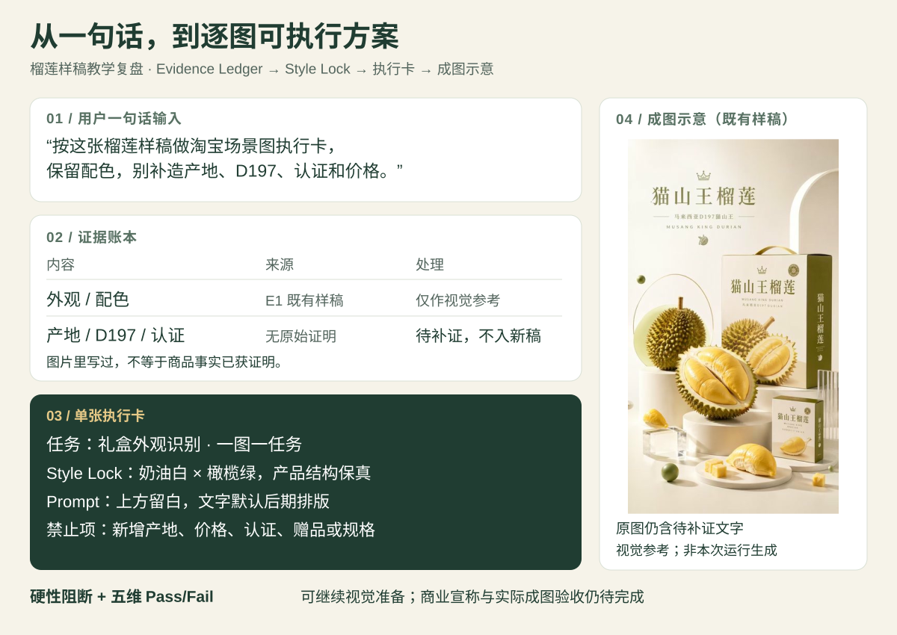
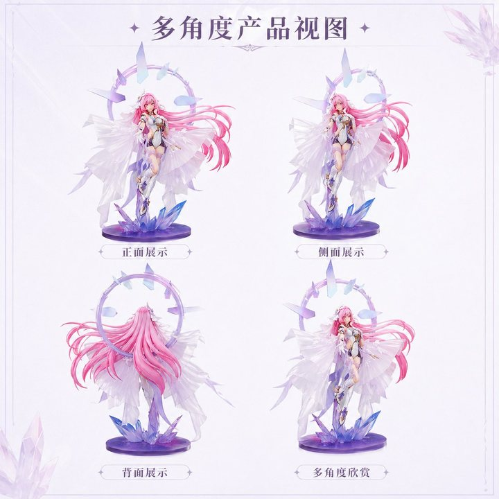

<div align="center">

# 🛒 E-commerce Visual Copywriting

### 电商视觉策划 · 主图 / 详情页 / Listing / A+ · 图内文案 · 生图 Prompt · 合规审查

**把零散商品资料，变成设计师和 AI 都能直接执行的电商视觉方案。**

[](SKILL.md)
[](SKILL.md)
[](https://skills.sh/feichanggege/ecommerce-visual-copywriting-skill)
[](LICENSE)
[](https://github.com/feichanggege/ecommerce-visual-copywriting-skill/actions/workflows/verify.yml)

**中文** · [English](README.en.md)

[30 秒上手](#-30-秒上手) · [它解决什么](#-它解决什么) · [工作流](#-工作流) · [支持平台](#-支持平台) · [效果展示](#-效果展示) · [安全边界](#-安全边界)

</div>

<p align="center">
  
</p>

图中是基于既有榴莲样稿的教学复盘：一句话输入 → 证据账本 → 单张执行卡 → 成图参考。原样稿的产地/D197文字尚待补证，不冒充新执行卡已完成的成图或商品事实。[查看完整输入、证据与执行卡](examples/durian-worked-example.md)。

它先明确购买理由，再建立**证据账本**、锁定 **Style Lock**，交付逐图画面、文案、排版说明和 Prompt。默认让生图模型留出文字区，文字交给设计师后期排版。

---

## ✨ 它解决什么

普通 AI 做电商视觉，常见问题不是“不会写”，而是：

| 常见问题 | 本 Skill 的处理方式 |
|---|---|
| 直接堆卖点，5 张图说同一件事 | 每张图只解决一个购买决策问题 |
| 参数很多，但用户不知道和自己有什么关系 | `Feature → Advantage → Benefit → Evidence` |
| 参考图越改越不像原产品 | `Reference Fidelity + Negative Constraints` 锁定包装、Logo、结构、规格 |
| “写猛一点”后出现功效、绝对化、虚假证据风险 | 先建证据账本，再做宣称分级 |
| 用户只想改现有详情页，却被从零重做 | 自动进入审查/改稿模式，做最小必要修改 |
| 跨境页面只是中文直译 | 按市场、单位、场景、表达习惯做本地化重写 |
| 平台规则已经变化，AI 仍引用旧经验 | 当前规则需要时优先核验官方最新来源 |
| 输出只有文字，设计师还要二次猜 | 逐图交付画面 + 文案 + 设计说明 + Prompt + 禁止项 |

---

## 🚀 30 秒上手

### 1. 安装

```bash
npx skills add feichanggege/ecommerce-visual-copywriting-skill
```

也支持 [Codex / Claude Code 手动安装、Claude plugin marketplace 与 Claude.ai ZIP 上传](#手动安装)。

### 2. 直接说需求

```text
这是我的产品资料、包装图和竞品参考。
面向 Amazon US，直接给我 7 张商品图 + A+ 视觉规划：
每张包含画面、英文图内文案、设计说明、生图 Prompt 和 Negative Prompt。
不要中途确认，缺失信息请标注假设，不要编造。
```

也可以更简单：

```text
帮我把这个商品做成一套能直接交给设计师的主图和详情页方案。
```

---

## 🧭 工作流


### 四种执行模式

| 模式 | 什么时候用 | 行为 |
|---|---|---|
| **标准模式** | 缺关键证据、方向不清、用户要求先确认 | 策略与证据缺口 → Storyboard 后合并确认一次 → 执行 |
| **一次性交付** | 用户明确“直接做完”或资料充分 | 不机械暂停，完整交付 |
| **审查 / 改稿** | 已有主图、详情页、文案、Prompt | 找问题 + 最小必要修改 |
| **设计师交接** | 需要直接开工的执行稿 | 使用固定结构输出逐图任务卡 |

未指定模式时按顺序判断：已有待审成品 → 审查；要给设计师/运营直接用 → 交接；本次范围的资料与必要证据齐全 → 一次性；缺证据或方向不清 → 标准模式。产品原图作为输入资料不自动触发审查，也不强制凑三条卖点。所有完整方案/策略/分镜与正式审查报告都读取同一份 [输出模板](references/output-contracts.md)。

### 新版 v3 核心能力

- **Evidence Ledger / 证据账本**：每条关键卖点标记“已确认 / 有依据 / 待补证 / 禁止”。
- **Reference Fidelity**：明确哪些元素必须保持、哪些可以变化。
- **Negative Prompt**：把包装变形、Logo 错误、规格变化、文字乱码、人物异常等提前写进禁止项。
- **动态图片数量**：5 张只是默认，不再为了凑数硬做 5 张。
- **多平台 Playbook**：国内电商 + Amazon / Shopify / TikTok Shop / Temu / Shopee / Lazada。
- **文字与排版规则**：主图1个标题 + 至多2条副文案 + 至多1个数字/证据标签；PDP模块1个标题 + 至多3条要点。标题≤12汉字/≤6英文词；主图副文案每条≤18汉字/≤10英文词，PDP要点每条≤18汉字/≤12英文词。均为默认建议值，不是平台规定；超限删减或拆图。
- **文字渲染二选一**：每卡选择“留白排版”（默认后期叠字）或“模型出字”（仅明确要求的短文字），并附文案规格自检、逐字验收与回退办法。声明底部可读，重要条件紧邻宣称。
- **六类成交驱动力**：视觉 / 痛点 / 参数 / 信任 / 情绪 / 价格与组合促销；价格需核对 SKU、数量、优惠门槛和活动时间。
- **跨境本地化**：不是直译，重写购买理由、单位、场景和信息密度。
- **硬性阻断 + Pass/Fail 质量门**：替代无锚点的“80/100”伪精确评分。

---

## 📦 能交付什么

### 视觉策略

- 成交驱动力：视觉 / 痛点 / 参数 / 信任 / 情绪 / 价格与组合促销
- 最多3条有依据的购买理由
- 证据账本
- `Feature → Advantage → Benefit → Evidence`
- Campaign Style Lock
- 缺失信息、假设与风险

### Storyboard

```text
KV1  Hero      → 一眼知道卖什么 + 为什么点进来
KV2  Benefit   → 把核心参数翻译成用户收益
KV3  Proof     → 用真实证据建立信任
KV4  Scene     → 让目标用户看到自己的使用场景
KV5  Spec/CTA  → 规格、组合、选择或行动信息
```

> 实际数量按平台和商品调整，不固定 5 张。

### 单张执行卡

每张图可直接交付：

- 视觉任务
- 画面 / 构图 / 镜头 / 光影 / 背景
- 图内文案
- 第一视觉落点
- 设计说明
- 生图 Prompt
- Negative Prompt / 禁止项
- 证据来源
- 合规 / 平台备注

---

## 🌍 支持平台

| 国内 | 跨境 / DTC |
|---|---|
| 淘宝 / 天猫 | Amazon Listing / A+ / Brand Story |
| 京东 | Shopify / DTC PDP |
| 拼多多 | TikTok Shop |
| 抖音小店 | Temu |
| 小红书商品图 / 笔记封面 | Shopee / Lazada |
| 视频号封面 / 微信小店商品图 | 其他商品详情页场景 |

平台相关内容分成两类处理：

1. **长期稳定的视觉策略**：使用 `references/platform-playbooks.md`。
2. **当前尺寸、主图限制、禁词、资质、审核规则**：需要时优先核验平台官方最新来源，不把旧经验写成现行规则。

抖音小店与 TikTok Shop 使用独立段落，跨境规则按国家/站点核验。[官方来源索引](references/source-notes.md) 区分法规文本、规则入口及登录/访问限制。

---

## 🧪 典型用法

### 先策划再执行

```text
帮我做一套淘宝主图和详情页。
先判断成交驱动力、风格锁和分镜，我确认后再做最终稿。
```

### 一次性完整交付

```text
资料已经齐了，直接一次性做完，不用中途确认。
输出主图、详情页、图内文案、设计说明和生图 Prompt。
```

### 审查已有页面

```text
不要重做。帮我检查这套详情页哪里影响转化、哪里有合规风险，
按优先级给最小修改方案和修正版。
```

### 参考图保真

```text
参考这张包装图做主图。
Logo、包装颜色、规格、罐型不能变，场景和光影可以变化。
```

### 跨境本地化

```text
把这套中文详情页改成 Shopify US 英文版。
不要直译，要按美国用户的购买逻辑重写。
```

更多示例见 [examples/README.md](examples/README.md)。

---

## 🖼 效果展示

<div align="center">
  <table>
    <tr>
      <td align="center" width="50%">
        <a href="assets/showcase/musang-king-durian-main.jpg">
          
        </a><br>
        <strong>高端食品 Hero / 主图</strong>
      </td>
      <td align="center" width="50%">
        <a href="assets/showcase/figure-multi-angle.jpg">
          
        </a><br>
        <strong>多角度产品表达</strong>
      </td>
    </tr>
    <tr>
      <td align="center" width="50%">
        <a href="assets/showcase/figure-desktop-scene.jpg">
          
        </a><br>
        <strong>真实场景详情模块</strong>
      </td>
      <td align="center" width="50%">
        <a href="assets/showcase/lumina-pendant-lamp.jpg">
          
        </a><br>
        <strong>材质与光影表达</strong>
      </td>
    </tr>
  </table>
</div>

> 展示图用于说明视觉交付形态，不代表对应商品的法律意见、平台审核承诺或商业数据证明。

每张图均≤500KB，榴莲缩略图保留完整竖图比例。当前素材体积已缩减；历史大图仍在 Git 记录，快速获取可使用浅克隆或下载当前源码包。

---

## 🛡 安全边界

这个 Skill **不会**：

- 编造检测报告、认证、专利、批准文号、销量、评价、排名或用户证言。
- 把“待补证”的内容写成确定事实。
- 因为用户要求“更猛”就突破医疗、食品、健康或平台合规边界。
- 用一句免责声明去“洗白”本身不允许的功效宣称。
- 把历史平台经验当成当前平台硬规则。
- 为了视觉效果擅自改错产品包装、Logo、规格或结构。

合规框架见 [references/compliance-rules.md](references/compliance-rules.md)。

---

## 🗂 仓库结构

```text
SKILL.md                          # Canonical runtime entrypoint
SKILL.en.md                       # 完整英文规则，与中文章节对齐
agents/openai.yaml                # ChatGPT UI metadata
references/compliance-rules.md    # 证据与合规框架
references/platform-playbooks.md  # 多平台视觉策略
references/output-contracts.md    # 设计师交付 / 审查 / 本地化模板
references/source-notes.md        # 官方法规/平台入口与核验范围
examples/README.md                # 典型输入与期望行为
examples/durian-worked-example.md # 榴莲样稿教学复盘
scripts/count-copy.py             # 按最终字串计算文案长度
assets/showcase/                  # 效果展示
assets/showcase-output.svg        # 结构化输出示意
tools/verify-skill.py             # 发布前结构与隐私检查
tools/evaluate-prompts.py         # 已保存模型输出的文本断言
tools/package-skill.py            # 最小 Skill ZIP
test-prompts.json                 # 14 类提示词与可检查期望
.github/workflows/verify.yml      # GitHub Actions
CHANGELOG.md                      # 已发布与未发布变更
```

---

## ✅ 验证

```bash
python tools/verify-skill.py
python -m unittest discover -s tests -v
```

CI 运行仓库检查、回归测试和最小 ZIP 打包。徽章链接真实 Actions 状态，首次推送工作流后才会产生远端结果；本地 Pass 不代表远端已变绿。

`test-prompts.json` 含 `must_include` 和 `must_not_include`。保存 Agent 的实际输出后运行 `python tools/evaluate-prompts.py --responses responses.json`；禁用宣称只检查独立的最终文案，允许分析部分引用风险词。[响应格式与检查边界](examples/README.md#自动检查实际输出)。结构/文本检查不替代语义、合规与实际成图验收。

已存在 [v3.0.0 Release](https://github.com/feichanggege/ecommerce-visual-copywriting-skill/releases/tag/v3.0.0)；本次改动见 [CHANGELOG.md](CHANGELOG.md) 的 Unreleased，不重复创建旧 tag。

---

## 手动安装

macOS / Linux：

```bash
git clone --depth 1 https://github.com/feichanggege/ecommerce-visual-copywriting-skill.git
mkdir -p ~/.codex/skills/ecommerce-visual-copywriting
cp -r ecommerce-visual-copywriting-skill/SKILL.md \
      ecommerce-visual-copywriting-skill/SKILL.en.md \
      ecommerce-visual-copywriting-skill/LICENSE \
      ecommerce-visual-copywriting-skill/agents \
      ecommerce-visual-copywriting-skill/references \
      ecommerce-visual-copywriting-skill/examples \
      ecommerce-visual-copywriting-skill/scripts \
      ~/.codex/skills/ecommerce-visual-copywriting/
```

Windows PowerShell：

```powershell
$ErrorActionPreference = 'Stop'
git clone --depth 1 https://github.com/feichanggege/ecommerce-visual-copywriting-skill.git
New-Item -ItemType Directory -Force "$env:USERPROFILE\.codex\skills\ecommerce-visual-copywriting" | Out-Null
Copy-Item -Recurse ecommerce-visual-copywriting-skill\SKILL.md,ecommerce-visual-copywriting-skill\SKILL.en.md,ecommerce-visual-copywriting-skill\LICENSE,ecommerce-visual-copywriting-skill\agents,ecommerce-visual-copywriting-skill\references,ecommerce-visual-copywriting-skill\examples,ecommerce-visual-copywriting-skill\scripts "$env:USERPROFILE\.codex\skills\ecommerce-visual-copywriting\"
```

### Claude Code

手动安装使用相同文件集合，把上面目标目录换成 `~/.claude/skills/ecommerce-visual-copywriting/`（个人），或项目内 `.claude/skills/ecommerce-visual-copywriting/`。Codex 项目安装可使用项目内 `.codex/skills/ecommerce-visual-copywriting/`。不要只复制 `SKILL.md` 而漏掉 references。

也可以在 Claude Code 中使用仓库自带的 marketplace：

```text
/plugin marketplace add feichanggege/ecommerce-visual-copywriting-skill
/plugin install ecommerce-visual-copywriting@ecommerce-visual-copywriting-skill
```

检查插件列表或重启会话确认加载；发布者可运行 `claude plugin validate .`。本仓库根目录的 `SKILL.md` 由根 Skill 插件机制加载，元数据在 `.claude-plugin/plugin.json`。[官方 Skill 路径](https://code.claude.com/docs/en/skills) · [marketplace 安装说明](https://code.claude.com/docs/en/plugin-marketplaces)。

### Claude.ai 上传 ZIP

在仓库目录生成轻量包：

```text
python tools/package-skill.py --output dist/ecommerce-visual-copywriting.zip
```

ZIP 内只有一层 `ecommerce-visual-copywriting/` Skill 文件夹，包含入口、英文版、agents、references、examples、计数脚本与许可证，不含 `.git`、工程测试或展示原图。按 Claude 当前界面的 **Customize → Skills → 创建/上传 Skill** 上传 ZIP 并启用；账号/组织须开放相应能力及代码执行。[官方上传说明](https://support.claude.com/en/articles/12512180-use-skills-in-claude)。

---

## License

[MIT](LICENSE)

<div align="center">

**先把“为什么买”讲清楚，再把每一张图做对。**

</div>
